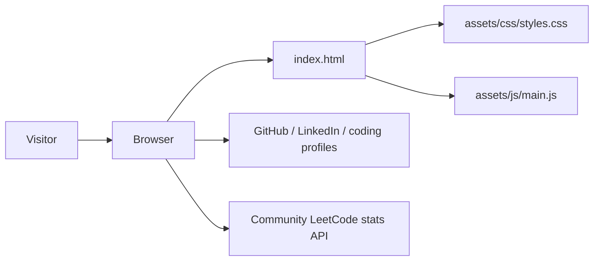

# Architecture

## Current implementation

The portfolio is a static, browser-rendered site. There is no server-side runtime or build pipeline.

## Components

- `index.html`: semantic page structure, portfolio copy, project roadmap, and external links.
- `assets/css/styles.css`: visual tokens, layout, responsive states, focus styles, and reduced-motion behavior.
- `assets/js/main.js`: mobile navigation, current-year enhancement, and LeetCode stats/submission fetch and refresh.
- `assets/img/`: legacy profile/work images retained in the repository but not used as project evidence by the current page.
- Markdown files in the repository root: requirements, design, implementation, setup, operational guidance, and future-feature boundaries.

## Runtime and deployment

- A static HTTP server serves the project directory.
- The browser loads CSS and JavaScript locally.
- Public LeetCode profile stats and recent submissions are fetched from a community API; other external destinations are user-initiated links.
- Deployment can use any static host or a web server configured to serve `index.html`.
- No server, build, runtime package, environment variable, or cloud account is needed to preview the current version.

## Data flow and trust boundaries

Most displayed portfolio content is checked into the static source. The LeetCode panel fetches public profile statistics using a fixed username; no visitor input or credentials are sent. Public profile links leave the site only after the visitor selects them. Never put credentials in static HTML, CSS, or JavaScript: every shipped browser asset is public.

## Future architecture options

- For infrequently changed content, keep projects in HTML or extract a local JSON file; a database is unnecessary.
- If a contact form becomes necessary, post to a managed form provider or a small server-side endpoint. Keep provider secrets server-side and add abuse prevention.
- Add a database only when a real requirement needs persistent dynamic content, ownership controls, or querying.
- Treat MCP as a private development-time integration, never a public browser dependency.

Any future dynamic service requires a new architecture review, threat model, and deployment documentation before shipping.
